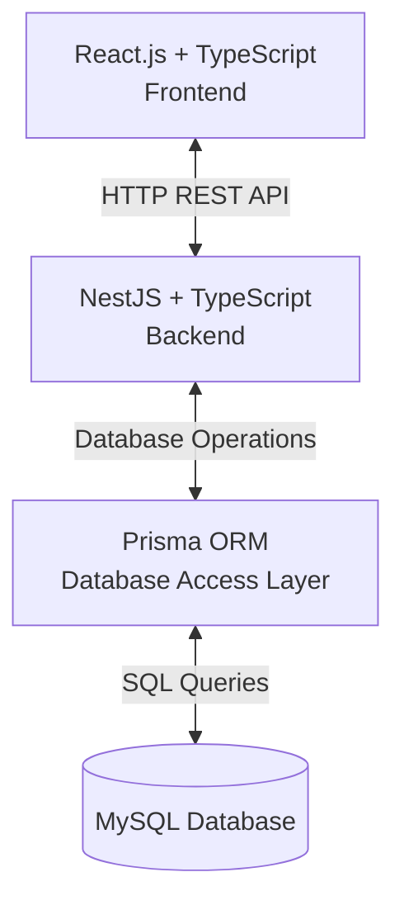

# Intern Ticket Portal – System Architecture

## 1. Project Overview

The Intern Ticket Portal is a ticket management application.

The application uses React.js and TypeScript for the frontend, NestJS and TypeScript for the backend, and MySQL as the relational database. Prisma ORM is used for database schema management and database operations.

## 2. System Architecture Diagram



## 3. Technology Components and Their Purpose

| Component | Purpose |
|---|---|
| React.js | Creates the user interface for the ticket portal. |
| TypeScript | Provides type safety and helps prevent coding errors. |
| NestJS | Handles API requests and backend business logic. |
| Prisma ORM | Connects the backend application to the database. |
| MySQL | Stores tickets, users, categories and other application data. |
| REST API | Enables communication between React and NestJS. |

## 4. Frontend Folder Structure

Project location: `sandbox/ticket-prototype/`

```text
ticket-prototype/
│
├── dist/
│   ├── assets/
│   ├── favicon.svg
│   └── index.html
│
├── node_modules/
│
├── public/
│   ├── favicon.svg
│   └── icons.svg
│
├── src/
│   ├── assets/
│   │   ├── hero.png
│   │   ├── react.svg
│   │   └── vite.svg
│   │
│   ├── components/
│   │   ├── StatusBadge.tsx
│   │   ├── TicketForm.tsx
│   │   ├── TicketList.tsx
│   │   └── TicketRow.tsx
│   │
│   ├── App.css
│   ├── App.tsx
│   ├── index.css
│   ├── main.tsx
│   └── types.ts
│
├── types/
│   └── ticket.ts
│
├── .gitignore
├── .oxlintrc.json
├── eslint.config.js
├── index.html
├── package-lock.json
├── package.json
├── README.md
├── tsconfig.app.json
├── tsconfig.json
├── tsconfig.node.json
└── vite.config.ts
```

### Frontend Folder Explanation

- dist: Contains the production build output.
- node_modules: Contains installed frontend packages.
- public: Stores static files such as icons.
- src/assets: Stores images and other assets.
- src/components: Contains reusable React components.
- StatusBadge.tsx: Displays ticket status.
- TicketForm.tsx: Provides the ticket creation form.
- TicketList.tsx: Displays the list of tickets.
- TicketRow.tsx: Displays an individual ticket.
- App.tsx: Main React application component.
- App.css: Contains application component styles.
- index.css: Contains global CSS styles.
- main.tsx: Entry point of the React application.
- types.ts: Contains TypeScript type definitions.
- types/ticket.ts: Contains ticket-related types.
- package.json: Stores dependencies and scripts.
- vite.config.ts: Contains Vite configuration.

## 5. Backend Folder Structure

Project location: `sandbox/nest-basics/`

```text
nest-basics/
│
├── dist/
│   ├── categories/
│   ├── app.controller.d.ts
│   ├── app.controller.js
│   ├── app.controller.js.map
│   ├── app.module.d.ts
│   ├── app.module.js
│   ├── app.module.js.map
│   ├── app.service.d.ts
│   ├── app.service.js
│   ├── app.service.js.map
│   ├── main.d.ts
│   ├── main.js
│   └── main.js.map
│
├── node_modules/
│
├── src/
│   ├── categories/
│   ├── app.controller.spec.ts
│   ├── app.controller.ts
│   ├── app.module.ts
│   ├── app.service.ts
│   └── main.ts
│
├── test/
│   └── app.e2e-spec.ts
│
├── .env
├── .gitattributes
├── .gitignore
├── .oxlintrc.json
├── .prettierrc
├── AGENTS.md
├── nest-cli.json
├── package.json
├── package-lock.json
├── README.md
├── tsconfig.build.json
├── tsconfig.json
├── vitest.config.e2e.ts
└── vitest.config.ts
```

### Backend Folder Explanation

- dist: Contains compiled backend JavaScript files.
- node_modules: Contains installed backend dependencies.
- src: Contains NestJS source code.
- src/categories: Contains category-related functionality.
- app.controller.ts: Handles incoming HTTP requests.
- app.controller.spec.ts: Contains controller unit tests.
- app.module.ts: Main NestJS application module.
- app.service.ts: Contains application service logic.
- main.ts: Entry point of the NestJS application.
- test: Contains end-to-end testing files.
- .env: Stores environment variables.
- nest-cli.json: Contains NestJS CLI configuration.
- package.json: Stores dependencies and scripts.
- tsconfig.json: Contains TypeScript configuration.

## 6. Database Folder Structure

Project location: `sandbox/prisma-basics/`

```text
prisma-basics/
│
├── .agents/
│   └── skills/
│       ├── prisma-composer-core-concepts/
│       └── prisma-platform-core-concepts/
│
├── .claude/
├── .cursor/
├── .devin/
│
├── generated/
│   └── prisma/
│       ├── internal/
│       ├── models/
│       ├── browser.ts
│       ├── client.ts
│       ├── commonInputTypes.ts
│       ├── enums.ts
│       └── models.ts
│
├── node_modules/
│
├── prisma/
│   ├── migrations/
│   └── schema.prisma
│
├── scripts/
│   └── crud.ts
│
├── .env
├── package.json
├── package-lock.json
└── prisma.config.ts
```

### Database Folder Explanation

- generated/prisma: Contains generated Prisma client files.
- node_modules: Contains installed Prisma dependencies.
- prisma: Contains database schema and migrations.
- migrations: Stores database migration history.
- schema.prisma: Defines database models and relationships.
- scripts/crud.ts: Contains CRUD practice operations.
- .env: Stores database connection details.
- package.json: Stores Prisma dependencies and scripts.
- prisma.config.ts: Contains Prisma configuration.

## 7. Application Request Flow

1. The user interacts with the React frontend.
2. React sends an HTTP REST API request to NestJS.
3. NestJS receives and processes the request.
4. Prisma performs database operations.
5. MySQL stores or retrieves the required information.
6. NestJS sends the response to React.
7. React displays the result to the user.


## 8. Important Implementation Note

The frontend, NestJS backend and Prisma practice project are currently maintained in separate folders.

The intended application architecture is React → NestJS → Prisma → MySQL.

The Prisma integration with NestJS must be verified before considering the complete database flow implemented.
 